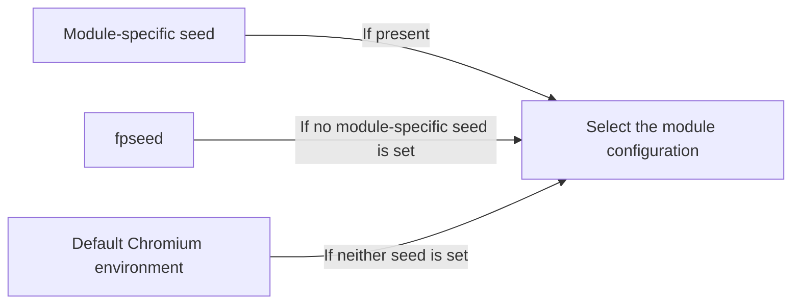

<div align="center">

<h1>YSbrowser</h1>

<p><strong>A deeply customized Chromium-based browser for Windows</strong></p>
<p>A stable, reproducible browser environment with independent configuration for each instance</p>

[](https://github.com/selfshore/YSbrowser/releases/latest)
[](https://github.com/selfshore/YSbrowser/releases)
[](https://github.com/selfshore/YSbrowser/stargazers)
[](https://github.com/selfshore/YSbrowser/releases)

[Download](https://github.com/selfshore/YSbrowser/releases/latest) · [Quick Start](#quick-start) · [Command-Line Options](#command-line-options) · [Report an Issue](https://github.com/selfshore/YSbrowser/issues)

[English](README-en.md) | [中文](README.md)

[SDK documentation](https://selfshore.github.io/YSbrowser/sdk/0.11.3/README.html) · [PyPI](https://pypi.org/project/ysbrowser-sdk/)

</div>

---

> **Documentation version**: This page describes the new version. For older browser releases, see the [legacy English documentation](docs/legacy/README-en.md) or [旧版中文说明](docs/legacy/README.md). Options may differ between versions; use the instructions for your release.

## Introduction

YSbrowser is a customized Chromium-based desktop browser for Windows. The new version configures the browser environment at the browser engine level, with support for separate user data directories, authenticated proxies, WebRTC address policies, and reproducible configurations for Canvas, WebGL, Audio, fonts, screens, and text geometry.

The same launch options and seeds consistently select the same environment. When each instance uses a different `--user-data-dir`, its cookies, cache, LocalStorage, IndexedDB, and site permissions are isolated from those of other instances.

> The current graphics implementation targets Windows x64 and Chromium's default ANGLE D3D11 rendering path. If you force Vulkan, OpenGL, or SwiftShader, WebGL rendering results are not guaranteed to match those produced by D3D11.

## What's New

<table>
<tr>
<td width="50%" valign="top">

### 🧩 Environment Configuration

- Timezone, language, CPU, memory, and operating system version
- Screen and device scaling settings
- Fonts and SpeechSynthesis voice combinations
- Independent DOMRect and SVGRect configuration
- WebRTC candidate address policies

</td>
</tr>
<tr>
<td width="50%" valign="top">

### 🌐 Networking

- HTTP, HTTPS, and SOCKS5 proxies
- Username and password authentication
- Proxy switching for individual instances while the browser is running
- Switching the proxy for instance A does not change instance B
- Independent control over the address exposed through WebRTC

</td>
<td width="50%" valign="top">

### 🛠️ Usability

- Support for CDP, Playwright, Patchright, and Puppeteer
- Instance numbers on window and taskbar icons
- Extension developer mode enabled by default
- Direct pasting into the DevTools console
- JavaScript source maps disabled by default

</td>
</tr>
</table>

## Quick Start

Download the Windows archive from [Releases](https://github.com/selfshore/YSbrowser/releases), extract it, and run `YSbrowser.exe`.

Recommended minimal configuration:

```powershell
.\YSbrowser.exe `
  --user-data-dir="D:\YSbrowser\profiles\profile-01" `
  --fpseed="profile-01" `
  --timezone="Asia/Shanghai" `
  --lang="zh-CN" `
  --accept-lang="zh-CN,zh,en"
```

Each concurrently running instance must use a different user data directory. Do not let two processes open the same directory at the same time, as Chromium's directory locking and data writes may conflict.

## How Seeds Work

The new version uses a general seed together with module-specific seeds:



Precedence:

```text
Module-specific seed  >  fpseed  >  Default Chromium behavior
```

For example:

```powershell
.\YSbrowser.exe `
  --user-data-dir="D:\YSbrowser\profiles\profile-02" `
  --fpseed="account-02" `
  --canvas-seed="canvas-02" `
  --webgl-seed="webgl-02"
```

Canvas uses `canvas-02`, and WebGL uses `webgl-02`. Other modules that support the general seed derive their configurations from `account-02`.

The same string always maps to the same configuration. Changing a seed does not guarantee that every hash displayed by every detection website will change, because websites use different drawing content and data collection APIs.

## Command-Line Options

### General and Module-Specific Seeds

| Option | Example | Description |
| --- | --- | --- |
| `--fpseed` | `profile-01` | General configuration seed, used as a fallback by individual modules |
| `--canvas-seed` | `canvas-01` | Canvas fingerprint |
| `--webgl-seed` | `webgl-01` | WebGL fingerprint |
| `--audio-seed` | `audio-01` | OfflineAudioContext output configuration |
| `--font-seed` | `font-01` | Font fingerprint |
| `--speech-seed` | `speech-01` | Select a SpeechSynthesis voice combination |
| `--screen-seed` | `screen-01` | Select an internally consistent desktop screen configuration |
| `--rect-seed` | `rect-01` | Shared fallback seed for DOMRect and SVGRect |
| `--domrect-seed` | `dom-01` | Control DOMRect only; takes precedence over `--rect-seed` |
| `--svgrect-seed` | `svg-01` | Control SVGRect only; takes precedence over `--rect-seed` |

The precedence for DOMRect and SVGRect is:

```text
domrect-seed > rect-seed > fpseed > Default behavior
svgrect-seed > rect-seed > fpseed > Default behavior
```

### Server GPU Configuration

Use `--server-gpu-profile` to select the GPU configuration exposed to web pages on a Windows server, including environments without a dedicated graphics card. This mode uses the WARP software graphics backend for rendering and configures the GPU identity exposed through WebGL and WebGPU according to the selected model.

For example, launch with the RTX 3060 profile:

```powershell
.\YSbrowser.exe `
  --user-data-dir="D:\YSbrowser\profiles\server-01" `
  --server-gpu-profile=rtx3060 `
  --no-first-run
```

You can also add `--fpseed` or module-specific seeds to configure other modules. An explicitly selected, valid `--server-gpu-profile` takes precedence when choosing the GPU identity; `--webgl-seed` can still participate in selecting rendering execution parameters.

The following 26 GPU models are currently supported. Replace `rtx3060` in the example with the corresponding option value:

| Brand | GPU Model | Option Value |
| --- | --- | --- |
| NVIDIA | GeForce GT 610 | `gt610` |
| NVIDIA | GeForce GT 710 | `gt710` |
| NVIDIA | GeForce GT 730 | `gt730` |
| NVIDIA | GeForce GTX 750 Ti | `gtx750ti` |
| NVIDIA | GeForce GTX 1050 Ti | `gtx1050ti` |
| NVIDIA | GeForce GTX 1660 SUPER | `gtx1660super` |
| NVIDIA | GeForce RTX 2060 SUPER | `rtx2060super` |
| NVIDIA | GeForce RTX 2070 | `rtx2070` |
| NVIDIA | GeForce RTX 2080 Ti | `rtx2080ti` |
| NVIDIA | GeForce RTX 3060 | `rtx3060` |
| NVIDIA | GeForce RTX 3060 Ti | `rtx3060ti` |
| NVIDIA | GeForce RTX 3070 | `rtx3070` |
| NVIDIA | GeForce RTX 3070 Ti | `rtx3070ti` |
| NVIDIA | GeForce RTX 3080 Ti | `rtx3080ti` |
| NVIDIA | GeForce RTX 4060 | `rtx4060` |
| NVIDIA | GeForce RTX 4070 | `rtx4070` |
| NVIDIA | GeForce RTX 4070 SUPER | `rtx4070super` |
| NVIDIA | GeForce RTX 4090 | `rtx4090` |
| NVIDIA | GeForce RTX 5080 | `rtx5080` |
| AMD | Radeon RX 6500 XT | `rx6500xt` |
| AMD | Radeon RX 6700 | `rx6700` |
| AMD | Radeon RX 6750 GRE 12GB | `rx6750gre12gb` |
| Intel | HD Graphics 630 | `hdgraphics630` |
| Intel | UHD Graphics 630 | `uhdgraphics630` |
| Intel | UHD Graphics 730 | `uhdgraphics730` |
| Intel | UHD Graphics 770 | `uhdgraphics770` |

For example, `--server-gpu-profile=rtx4060` selects the RTX 4060 profile, and `--server-gpu-profile=rx6700` selects the RX 6700 profile.

Actual extensions, shader precision, feature support, resource limits, and rendering results remain subject to the execution backend and are not guaranteed to match the target physical GPU exactly. The `gt610`, `rtx2060super`, `rx6750gre12gb`, and `hdgraphics630` profiles currently lack corresponding WebGPU reference data.

### System and Region

| Option | Example | Description |
| --- | --- | --- |
| `--timezone` | `Asia/Kuala_Lumpur` | Set the IANA timezone used by web pages |
| `--lang` | `en-US` | Set the browser interface language |
| `--accept-lang` | `en-US,en` | Set the language list exposed to web pages and the HTTP `Accept-Language` header |
| `--cpucores` | `8` | Set `navigator.hardwareConcurrency` |
| `--memory` | `8` | Set `navigator.deviceMemory` |
| `--platformversion` | `19.0.0` | Set `platformVersion` in Client Hints |
| `--chrome-version` | `154.0.0.0` | Set the reported version information and related JavaScript API values |
| `--geolocation` | `3.1390,101.6869,100` | Set latitude, longitude, and accuracy in meters |
| `--iconumber` | `12` | Display an instance number on the window icon and Windows taskbar icon |

For language settings, set both `--lang` and `--accept-lang`. The timezone, language, and proxy location should form a plausible regional environment. For example:

```powershell
--timezone="Asia/Kuala_Lumpur" --lang="en-US" --accept-lang="en-US,en"
```

The geolocation option uses the format `--geolocation=latitude,longitude,accuracy`. Accuracy is optional and defaults to `100` meters when omitted:

```powershell
--geolocation="3.1390,101.6869,100"
--geolocation="3.1390,101.6869"
```

Latitude must be between `-90` and `90`, longitude between `-180` and `180`, and accuracy must be nonnegative. This option changes the location returned by `navigator.geolocation`, but does not automatically grant websites access to it. The page must still run in a secure context and obtain geolocation permission.

### Network Proxies

| Option | Example | Description |
| --- | --- | --- |
| `--proxy-server` | `http://127.0.0.1:8080` | Set an HTTP, HTTPS, or SOCKS5 proxy |
| `--proxy-auth` | `username:password` | Set the proxy username and password |
| `--webrtc-ip-policy` | `disabled` | Prevent WebRTC from exposing address candidates |
| `--webrtc-ip-policy` | `proxy` | Enable a custom WebRTC address policy |
| `--webrtc-proxy-ip` | `203.0.113.10` | Set the address exposed through WebRTC |

Authenticated proxy example:

```powershell
.\YSbrowser.exe `
  --user-data-dir="D:\YSbrowser\profiles\proxy-01" `
  --proxy-server="http://127.0.0.1:8080" `
  --proxy-auth="username:password" `
  --webrtc-ip-policy="proxy" `
  --webrtc-proxy-ip="203.0.113.10"
```

`--webrtc-proxy-ip` only controls the candidate address exposed through WebRTC; it does not replace a network proxy. Outbound HTTP traffic still uses `--proxy-server` or the system's network configuration.

Command-line options may be visible to local process management tools. Do not expose real proxy passwords in screenshots, logs, or public issues.

### Automation and Instance Management

| Option | Example | Description |
| --- | --- | --- |
| `--user-data-dir` | `D:\YSbrowser\profiles\01` | Set a separate user data directory |
| `--remote-debugging-port` | `9222` | Open a CDP debugging port |
| `--iconumber` | `1` | Label the browser window and taskbar icon |

CDP launch example:

```powershell
.\YSbrowser.exe `
  --user-data-dir="D:\YSbrowser\profiles\automation-01" `
  --remote-debugging-port=9222 `
  --iconumber=1 `
  --fpseed="automation-01"
```

A second instance should use a different directory and port. CDP debugging ports should only be accessible on trusted networks.

## Recommended Configuration Example

The following example uses a stable general seed with separate seeds for Canvas, WebGL, and fonts:

```powershell
.\YSbrowser.exe `
  --user-data-dir="D:\YSbrowser\profiles\my-001" `
  --fpseed="my-profile-001" `
  --canvas-seed="my-canvas-001" `
  --webgl-seed="my-webgl-001" `
  --font-seed="my-font-001" `
  --timezone="Asia/Kuala_Lumpur" `
  --lang="en-US" `
  --accept-lang="en-US,en" `
  --cpucores=8 `
  --memory=8 `
  --platformversion="19.0.0" `
  --geolocation="3.1390,101.6869,100" `
  --proxy-server="socks5://127.0.0.1:1080" `
  --webrtc-ip-policy="proxy" `
  --webrtc-proxy-ip="203.0.113.10" `
  --iconumber=1
```

To reuse the same environment over time, keep the user data directory, seeds, and complete launch options. Seeds do not store cookies, IndexedDB data, login sessions, or Visitor IDs assigned by a website's server.

### Sample Results from Online Tests

Online spot checks were performed with three representative configurations:

| Test Page | Observed Result |
| --- | --- |
| [Fingerprint Playground](https://demo.fingerprint.com/playground) | `tampering=false`, `anti_detect_browser=false` |
| [TZP Canvas Noise](https://arkenfox.github.io/TZP/tests/canvasnoise.html) | The write hash matched both read hashes |
| [BrowserScan](https://www.browserscan.net/zh) | No graphics consistency warnings; the WebGL hash changed with the seed |
| [CreepJS](https://abrahamjuliot.github.io/creepjs/) | Canvas and WebGL hashes changed with the seed |
| [PixelScan](https://pixelscan.net/fingerprint-check) | Reported a consistent browser fingerprint |

Detection websites and their rules change over time. The table reflects results for a particular build, driver, and test date, and does not provide a permanent guarantee for future versions or all websites.

## Consistency Recommendations

- Keep the proxy country, timezone, language, and geolocation consistent.
- Keep the Chrome version consistent with its supported APIs, Client Hints, and TLS capabilities.
- Use a GPU name, WebGL extensions, parameters, shader precision, and rendering results from the same configuration.
- Choose a CPU core count and memory combination that is typical of desktop devices.
- Keep screen dimensions, available screen area, scaling, and viewport size plausible.
- Keep the same environment consistent across the main page, iframes, Workers, and OffscreenCanvas.
- Avoid frequently changing seeds while an environment is in use.

## Frequently Asked Questions

<details>
<summary><strong>Why did the Visitor ID stay the same after I changed all the seeds?</strong></summary>

A Visitor ID usually depends on more than rendering fingerprints. Cookies, LocalStorage, IndexedDB, the user data directory, IP address, account, and server-side history may all contribute to identification. When testing a fresh environment, use a new `--user-data-dir` and make sure the previous browser processes have fully exited.

</details>

<details>
<summary><strong>Why did a website's Canvas or WebGL hash stay the same?</strong></summary>

Different websites use different drawing content and APIs. A configuration may affect text rasterization, complex shaders, or color quantization, but the result may remain the same if the test page does not exercise those paths. Use multiple websites and local pixel tests to determine whether a configuration has taken effect.

</details>

<details>
<summary><strong>Why do Chrome, CreepJS, and BrowserScan show different results?</strong></summary>

These pages use different signals, rendering samples, hash algorithms, and presentation methods. Different results do not automatically mean that the configuration has failed. First check whether the same website produces reproducible results with the same options.

</details>

<details>
<summary><strong>Can multiple instances share one user-data-dir?</strong></summary>

This is not recommended. Chromium locks a user data directory while it is in use. Concurrent writes may cause startup failures, data corruption, or configuration interference between instances. Each concurrent instance should use its own directory.

</details>

## Reporting Issues

Submit problems through [GitHub Issues](https://github.com/selfshore/YSbrowser/issues). Please include as much of the following as possible:

- YSbrowser version and Chromium major version
- Windows version and graphics driver version
- Complete launch options that are safe to share, with real IP addresses and passwords replaced by placeholders
- Whether the issue can be reproduced with a fresh user data directory
- Test URLs, screenshots, and clear steps to reproduce the issue
- `chrome://gpu` information for graphics-related issues

## Community

<div align="center">

**QQ Group: 1043047569**


</div>

## Disclaimer

YSbrowser is intended solely for browser compatibility research, privacy protection, automated testing, and personal learning. Users must comply with applicable local laws, the terms of service of target websites, and data authorization requirements. This project must not be used for unauthorized access, fraud, attacks, or other unlawful activities.

This project is provided as is. Browsers, graphics drivers, detection scripts, and website rules continually change. The maintainers do not guarantee continued compatibility with any particular website and accept no liability for data loss, account restrictions, or other losses arising from use of this project.

---

<div align="center">

If you find this project useful, consider giving it a ⭐

</div>
