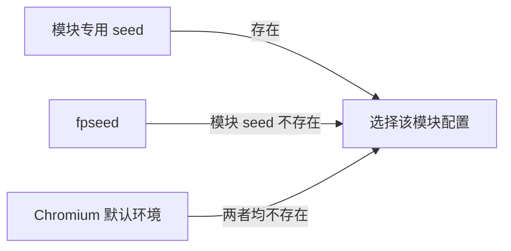

<div align="center">

<h1>YSbrowser</h1>

<p><strong>基于 Chromium 深度定制的 Windows / Linux 浏览器</strong></p>
<p>稳定、可复现、可独立配置的浏览器运行环境</p>

[](https://github.com/selfshore/YSbrowser/releases/latest)
[](https://github.com/selfshore/YSbrowser/releases)
[](https://github.com/selfshore/YSbrowser/stargazers)
[](https://github.com/selfshore/YSbrowser/releases)

[下载](https://github.com/selfshore/YSbrowser/releases/latest) · [使用说明](#快速开始) · [参数列表](#命令行参数) · [问题反馈](https://github.com/selfshore/YSbrowser/issues)

[English](README-en.md) | [中文](README.md)

[SDK 使用手册](https://selfshore.github.io/YSbrowser/sdk/0.11.5/README.html) · [PyPI](https://pypi.org/project/ysbrowser-sdk/)

</div>

---

> **文档版本**：本页为新版使用说明。使用旧版浏览器，请查看 [旧版中文说明](docs/legacy/README.md) · [Legacy English documentation](docs/legacy/README-en.md)。不同版本的参数可能不同，请按所用版本查阅。

## 简介

YSbrowser 是基于 Chromium 定制的 Windows / Linux 桌面浏览器。新版本把环境配置放在浏览器底层完成，支持独立用户目录、认证代理、WebRTC 地址策略，以及 Canvas、WebGL、Audio、字体、屏幕和文本几何等可复现配置。

同一套启动参数与种子会稳定选择同一套环境。不同实例使用不同的 `--user-data-dir` 后，Cookie、缓存、LocalStorage、IndexedDB 和站点权限彼此隔离。

> Windows 图形实现面向 Windows x64 和 Chromium 默认的 ANGLE D3D11 路径。强制使用 Vulkan、OpenGL 或 SwiftShader 时，WebGL 绘画结果不保证与 D3D11 相同。

## 新版本特性

<table>
<tr>
<td width="50%" valign="top">


### 🧩 环境配置

- 时区、语言、CPU、内存和系统版本
- 屏幕与设备缩放环境
- 字体与 SpeechSynthesis 语音组合
- DOMRect 与 SVGRect 独立配置
- WebRTC 候选地址策略

</td>
</tr>
<tr>
<td width="50%" valign="top">

### 🌐 网络能力

- HTTP、HTTPS、SOCKS5 代理
- 用户名和密码认证
- 支持浏览器运行期间按实例切换代理
- A 浏览器实例切换代理不会修改 B 实例
- WebRTC 展示地址可独立控制

</td>
<td width="50%" valign="top">

### 🛠️ 使用体验

- 支持 CDP、Playwright、Patchright 与 Puppeteer
- 窗口和任务栏图标可显示实例编号
- 扩展开发者模式默认开启
- DevTools 控制台允许直接粘贴
- JavaScript 源映射默认关闭

</td>
</tr>
</table>

## 快速开始

从 [Releases](https://github.com/selfshore/YSbrowser/releases) 下载 Windows 压缩包，解压后运行 `chrome.exe`。

6.4 的 Windows 包为 `chrome.7z`，入口为 `Chrome-bin/chrome.exe`。Linux 包为 `YSbrowser-154.0.8037.57-ubuntu24.04-x86_64.AppImage`，面向 Ubuntu 24.04 x86_64，要求 AVX2、FMA、F16C。下载后 `chmod +x` 即可执行，沙箱与 AppArmor 配置见同一 Release 的 `AppImage-README.txt`。两端均支持 SDK 0.11.5 自动下载和 SHA-256 校验：

```shell
python -m pip install --upgrade ysbrowser-sdk
python -m ysbrowser_sdk install
```

最小推荐配置：

```powershell
.\chrome.exe `
  --user-data-dir="D:\YSbrowser\profiles\profile-01" `
  --fpseed="profile-01" `
  --timezone="Asia/Shanghai" `
  --lang="zh-CN" `
  --accept-lang="zh-CN,zh,en"
```

每个同时运行的实例都必须使用不同的用户目录。不要让两个进程同时打开同一个目录，否则 Chromium 的目录锁和数据写入可能发生冲突。

## 种子工作方式

新版本使用“总体种子 + 模块种子”的结构：



优先级为：

```text
模块专用 seed  >  fpseed  >  Chromium 默认行为
```

例如：

```powershell
.\chrome.exe `
  --user-data-dir="D:\YSbrowser\profiles\profile-02" `
  --fpseed="account-02" `
  --canvas-seed="canvas-02" `
  --webgl-seed="webgl-02"
```

Canvas 使用 `canvas-02`，WebGL 使用 `webgl-02`；其余支持总体种子的模块从 `account-02` 派生。

相同字符串始终映射到相同配置。修改种子后，不保证每个检测网站展示的每一项 hash 都变化，因为网站使用的绘画内容和采集 API 并不相同。

## 命令行参数

### 总体与模块种子

| 参数 | 示例 | 作用 |
| --- | --- | --- |
| `--fpseed` | `profile-01` | 总体配置种子，作为各模块的后备来源 |
| `--canvas-seed` | `canvas-01` | Canvas 指纹 |
| `--webgl-seed` | `webgl-01` | WebGL指纹 |
| `--audio-seed` | `audio-01` | OfflineAudioContext 输出配置 |
| `--font-seed` | `font-01` | font指纹 |
| `--speech-seed` | `speech-01` | 选择 SpeechSynthesis 语音组合 |
| `--screen-seed` | `screen-01` | 选择一套内部一致的桌面屏幕配置 |
| `--rect-seed` | `rect-01` | DOMRect 与 SVGRect 的共同后备种子 |
| `--domrect-seed` | `dom-01` | 仅控制 DOMRect，优先于 `--rect-seed` |
| `--svgrect-seed` | `svg-01` | 仅控制 SVGRect，优先于 `--rect-seed` |

DOMRect 和 SVGRect 的优先级分别是：

```text
domrect-seed > rect-seed > fpseed > 默认行为
svgrect-seed > rect-seed > fpseed > 默认行为
```

### 服务器 GPU 配置

`--server-gpu-profile` 用于在 Windows 服务器上选择对网页展示的 GPU 配置，适用于没有独立显卡的环境。该模式使用 WARP 软件图形后端执行绘制，并按所选型号配置 WebGL、WebGPU 的显卡身份信息。

例如，使用 RTX 3060 配置启动：

```powershell
.\chrome.exe `
  --user-data-dir="D:\YSbrowser\profiles\server-01" `
  --server-gpu-profile=rtx3060 `
  --no-first-run
```

需要同时配置其他模块时，可以继续添加 `--fpseed` 或各模块专用种子。显式有效的 `--server-gpu-profile` 优先决定 GPU 身份；`--webgl-seed` 仍可参与绘制执行参数选择。

当前支持以下 26 种显卡型号，将示例中的 `rtx3060` 替换为对应参数值即可：

| 品牌 | 显卡型号 | 参数值 |
| --- | --- | --- |
| NVIDIA | GeForce GT 610 | `gt610` |
| NVIDIA | GeForce GT 710 | `gt710` |
| NVIDIA | GeForce GT 730 | `gt730` |
| NVIDIA | GeForce GTX 750 Ti | `gtx750ti` |
| NVIDIA | GeForce GTX 1050 Ti | `gtx1050ti` |
| NVIDIA | GeForce GTX 1660 SUPER | `gtx1660super` |
| NVIDIA | GeForce RTX 2060 SUPER | `rtx2060super` |
| NVIDIA | GeForce RTX 2070 | `rtx2070` |
| NVIDIA | GeForce RTX 2080 Ti | `rtx2080ti` |
| NVIDIA | GeForce RTX 3060 | `rtx3060` |
| NVIDIA | GeForce RTX 3060 Ti | `rtx3060ti` |
| NVIDIA | GeForce RTX 3070 | `rtx3070` |
| NVIDIA | GeForce RTX 3070 Ti | `rtx3070ti` |
| NVIDIA | GeForce RTX 3080 Ti | `rtx3080ti` |
| NVIDIA | GeForce RTX 4060 | `rtx4060` |
| NVIDIA | GeForce RTX 4070 | `rtx4070` |
| NVIDIA | GeForce RTX 4070 SUPER | `rtx4070super` |
| NVIDIA | GeForce RTX 4090 | `rtx4090` |
| NVIDIA | GeForce RTX 5080 | `rtx5080` |
| AMD | Radeon RX 6500 XT | `rx6500xt` |
| AMD | Radeon RX 6700 | `rx6700` |
| AMD | Radeon RX 6750 GRE 12GB | `rx6750gre12gb` |
| Intel | HD Graphics 630 | `hdgraphics630` |
| Intel | UHD Graphics 630 | `uhdgraphics630` |
| Intel | UHD Graphics 730 | `uhdgraphics730` |
| Intel | UHD Graphics 770 | `uhdgraphics770` |

例如，`--server-gpu-profile=rtx4060` 选择 RTX 4060，`--server-gpu-profile=rx6700` 选择 RX 6700。

实际扩展、Shader 精度、功能支持、资源上限和绘制结果仍受运行后端限制，不能保证与目标实卡完全相同。其中 `gt610`、`rtx2060super`、`rx6750gre12gb`、`hdgraphics630` 暂无对应的 WebGPU 参考数据。

### 系统与区域

| 参数 | 示例 | 作用 |
| --- | --- | --- |
| `--timezone` | `Asia/Kuala_Lumpur` | 设置网页环境使用的 IANA 时区 |
| `--lang` | `en-US` | 设置浏览器界面语言 |
| `--accept-lang` | `en-US,en` | 设置网页语言列表和 HTTP `Accept-Language` |
| `--cpucores` | `8` | 设置 `navigator.hardwareConcurrency` |
| `--memory` | `8` | 设置 `navigator.deviceMemory` |
| `--platformversion` | `19.0.0` | 设置 Client Hints 的 `platformVersion` |
| `--chrome-version` | `154.0.0.0` | 设置对外版本信息及相关 JavaScript 表面 |
| `--geolocation` | `3.1390,101.6869,100` | 设置纬度、经度和精度（米） |
| `--iconumber` | `12` | 在窗口图标和 Windows 任务栏图标上显示编号 |

语言建议同时设置 `--lang` 和 `--accept-lang`。时区、语言和代理位置应组成合理的地区环境，例如：

```powershell
--timezone="Asia/Kuala_Lumpur" --lang="en-US" --accept-lang="en-US,en"
```

定位参数格式为 `--geolocation=latitude,longitude,accuracy`。精度可以省略，省略时默认为 `100` 米：

```powershell
--geolocation="3.1390,101.6869,100"
--geolocation="3.1390,101.6869"
```

纬度范围是 `-90` 到 `90`，经度范围是 `-180` 到 `180`，精度必须是非负数。该参数修改 `navigator.geolocation` 返回的位置，但不会自动允许网站读取定位；网页仍需处于安全上下文并获得定位权限。

### 网络代理

| 参数 | 示例 | 作用 |
| --- | --- | --- |
| `--proxy-server` | `http://127.0.0.1:8080` | 设置 HTTP、HTTPS 或 SOCKS5 代理 |
| `--proxy-auth` | `username:password` | 设置代理用户名和密码 |
| `--webrtc-ip-policy` | `disabled` | 禁止 WebRTC 暴露地址候选 |
| `--webrtc-ip-policy` | `proxy` | 启用自定义 WebRTC 地址策略 |
| `--webrtc-proxy-ip` | `203.0.113.10` | 设置 WebRTC 展示地址 |

认证代理示例：

```powershell
.\chrome.exe `
  --user-data-dir="D:\YSbrowser\profiles\proxy-01" `
  --proxy-server="http://127.0.0.1:8080" `
  --proxy-auth="username:password" `
  --webrtc-ip-policy="proxy" `
  --webrtc-proxy-ip="203.0.113.10"
```

`--webrtc-proxy-ip` 只控制 WebRTC 对外展示的候选地址，不会替代网络代理。HTTP 请求的出口仍由 `--proxy-server` 或系统网络决定。

命令行参数可能被本机进程管理工具读取，不要在截图、日志或公开 Issue 中暴露真实代理密码。

### 自动化与实例管理

| 参数 | 示例 | 作用 |
| --- | --- | --- |
| `--user-data-dir` | `D:\YSbrowser\profiles\01` | 设置独立用户目录 |
| `--remote-debugging-port` | `9222` | 开放 CDP 调试端口 |
| `--iconumber` | `1` | 标记浏览器窗口和任务栏图标 |

CDP 启动示例：

```powershell
.\chrome.exe `
  --user-data-dir="D:\YSbrowser\profiles\automation-01" `
  --remote-debugging-port=9222 `
  --iconumber=1 `
  --fpseed="automation-01"
```

第二个实例应使用另一个目录和端口。CDP 调试端口只应开放在可信网络中。


## 推荐配置示例

下面的示例使用一套稳定的总体种子，并单独指定 Canvas、WebGL 和字体：

```powershell
.\chrome.exe `
  --user-data-dir="D:\YSbrowser\profiles\my-001" `
  --fpseed="my-profile-001" `
  --canvas-seed="my-canvas-001" `
  --webgl-seed="my-webgl-001" `
  --font-seed="my-font-001" `
  --timezone="Asia/Kuala_Lumpur" `
  --lang="en-US" `
  --accept-lang="en-US,en" `
  --cpucores=8 `
  --memory=8 `
  --platformversion="19.0.0" `
  --geolocation="3.1390,101.6869,100" `
  --proxy-server="socks5://127.0.0.1:1080" `
  --webrtc-ip-policy="proxy" `
  --webrtc-proxy-ip="203.0.113.10" `
  --iconumber=1
```

长期复用同一个环境时，应同时保留用户目录、种子和完整启动参数。种子不会保存 Cookie、IndexedDB、登录状态或网站在服务端分配的 Visitor ID。


### 在线抽样结果

使用 3 套代表性配置进行了在线抽样：

| 检测页面 | 观察结果 |
| --- | --- |
| [Fingerprint Playground](https://demo.fingerprint.com/playground) | `tampering=false`，`anti_detect_browser=false` |
| [TZP Canvas Noise](https://arkenfox.github.io/TZP/tests/canvasnoise.html) | 写入 hash 与两次读取 hash 一致 |
| [BrowserScan](https://www.browserscan.net/zh) | 未出现图形一致性警告，WebGL hash 随种子变化 |
| [CreepJS](https://abrahamjuliot.github.io/creepjs/) | Canvas 和 WebGL hash 随种子变化 |
| [PixelScan](https://pixelscan.net/fingerprint-check) | 显示浏览器指纹一致 |

检测网站和规则会更新。上表是指定构建、驱动和测试日期下的结果，不代表对未来版本或所有网站的永久保证。

## 一致性建议

- 代理国家、时区、语言和地理位置应一致
- Chrome 版本应与其支持的 API、Client Hints 和 TLS 能力一致
- GPU 名称、WebGL 扩展、参数、Shader 精度和绘画结果应来自同一套配置
- CPU 核心数与内存组合应符合常见桌面设备
- 屏幕尺寸、可用区域、缩放比例和视口应合理
- 同一个环境在主页面、iframe、Worker 和 OffscreenCanvas 中应保持一致
- 不要在环境使用过程中频繁更换种子

## 常见问题

<details>
<summary><strong>修改所有种子后，Visitor ID 为什么没有改变？</strong></summary>

Visitor ID 通常不只依赖绘画指纹。Cookie、LocalStorage、IndexedDB、用户目录、IP、账号和服务端历史记录都可能参与识别。进行全新环境测试时，需要换用新的 `--user-data-dir` 并确认旧浏览器进程已经完全退出。

</details>

<details>
<summary><strong>为什么某个网站的 Canvas 或 WebGL hash 没变？</strong></summary>

不同网站使用不同的绘画内容和 API。一套配置可能影响文字光栅、复杂 Shader 或颜色量化，但测试页面没有覆盖相应路径时，结果可能相同。判断是否生效应结合多个网站和本地像素测试。

</details>

<details>
<summary><strong>为什么 Chrome、CreepJS 和 BrowserScan 显示的结果不同？</strong></summary>

这些页面采集的信号、绘画样本、hash 算法和展示方式不同。不同结果并不自动表示配置失败，应先检查同一网站在相同参数下能否稳定复现。

</details>

<details>
<summary><strong>可以让多个实例共用一个 user-data-dir 吗？</strong></summary>

不建议。Chromium 会锁定正在使用的用户目录，同时写入可能造成启动失败、数据损坏或配置串用。每个并行实例都应使用独立目录。

</details>

## 反馈问题

请前往 [GitHub Issues](https://github.com/selfshore/YSbrowser/issues) 提交问题，并尽量包含：

- YSbrowser 版本和 Chromium 主版本
- Windows 版本及显卡驱动版本
- 可公开的完整启动参数，真实 IP 和密码请替换为占位符
- 使用全新用户目录后能否复现
- 测试网址、截图和明确的复现步骤
- 与图形相关的问题请附上 `chrome://gpu` 信息

## 交流

<div align="center">

**QQ 交流群：1043047569**


</div>

## 免责声明

YSbrowser 仅供浏览器兼容性研究、隐私保护、自动化测试和个人学习使用。使用者应遵守所在地法律、目标网站服务条款及数据授权要求，不得将本项目用于未经授权的访问、欺诈、攻击或其他违法行为。

本项目按现状提供。浏览器、显卡驱动、检测脚本和网站规则会持续变化，维护者不保证任何特定网站始终可用，也不对使用本项目产生的数据丢失、账号限制或其他损失承担责任。

---

<div align="center">

如果这个项目对你有帮助，欢迎点一个 ⭐

</div>
